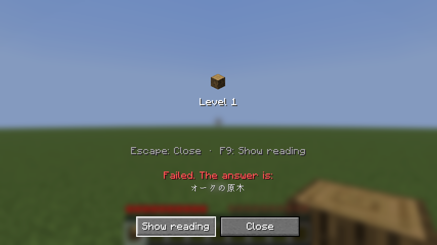

  

<h1 align="center">Oboecraft</h1>

  A vibe-coded Minecraft mod that locks every item until you can name it in Japanese, German, Norwegian Bokmål or Dutch.

  

Punch a tree and you get a log you can't use. To place it, craft with it or put it in a chest, you first type its name from the Japanese version of the game: サクラの原木. A correct answer unlocks every log of that kind for ten minutes. Each correct answer after that keeps it unlocked for longer, from an hour to a day to a month, until the word is mastered and never locks again. This is spaced repetition, and the game is the flashcard deck.

- **Any way of writing it counts.** サクラの原木, さくらのげんぼく and `sakura no genboku` all pass. The sound must be right, and so must the kanji: 元木 has the same sound and still fails.
- **Mistakes cost items.** You get two attempts. A fail removes up to half of that item from your inventory, moves it down a level and bans it for five minutes, so it can't be answered until the ban ends. Words you have known for longer lose less.
- **New items start with a lesson**, where you can see the answer and nothing is lost.
- **Names stay hidden.** A locked item is called `???` until you answer.
- **Hear every Japanese word.** After a correct answer, a voice says the name, so you learn how it sounds. Its volume is the Voice/Speech slider under Options → Music & Sounds.
- **Don't let your reviews pile up.** If you carry five or more items you have learned that are locked again, a 付喪神 (tsukumogami) follows you: a noh mask that came alive, with your overdue items circling its shoulders. The more items are overdue, the harder it is to kill. It suspends attacks while another mob within 32 blocks targets you and for five safe seconds afterward. It stands still while you answer, you can't sleep while it follows you, and it fades away once you review enough of what you carry. It stays through sunrise; killing it gives 12,000 game ticks of relief (about 10 minutes at 20 ticks per second).

<table>
  <tr>
    <td></td>
    <td></td>
  </tr>
  <tr>
    <td>A correct answer shows how the name is written, kanji included, and says it aloud.</td>
    <td>A fail shows the Japanese name first. Press F9 to reveal its reading.</td>
  </tr>
  <tr>
    <td></td>
    <td></td>
  </tr>
  <tr>
    <td>Unlocked items show when they lock again. The amber corner means soon.</td>
    <td>The word list, from the あ button in the inventory, shows the words you are learning, with their levels and lock timers, and keeps known, ignored and mastered words.</td>
  </tr>
</table>

## Installing

You need Minecraft: Java Edition 26.3 with [Fabric Loader](https://fabricmc.net/use/) 0.20.1 or newer and [Fabric API](https://modrinth.com/mod/fabric-api). Download `oboecraft-<version>.jar` from the [latest release](https://github.com/willdalh/oboecraft/releases/latest) and put it in your `mods` folder with Fabric API.

On a server, install the mod on the server too. Players need the same version of Oboecraft to join. The server checks every answer. Your progress is kept on your computer and goes with you to all your worlds and to every server.

Set the game language to 日本語 under Options → Language, so the names you learn are the ones you see. Locks only apply in survival and adventure mode.

## Learning languages

Your Minecraft language setting chooses what you learn:

| Game language | Learning language |
|---|---|
| Japanese (`ja_jp`) | Japanese |
| German (`de_de`) | German |
| Norsk bokmål (`no_no`) | Norwegian Bokmål |
| Dutch (`nl_nl`) | Dutch |
| Every other language, including `de_at`, `de_ch`, `nn_no` and `nl_be` | Japanese |

Each language has separate progress that follows you between worlds. Different players can learn different languages on the same server. Changing the game language in a world takes effect for learning on the next join; a chat message reminds you. Until then, unlocked names follow the new game language but answers stay in the current learning language.

German, Bokmål and Dutch use Minecraft's own item names. Case, spacing and punctuation don't matter; keyboard spellings such as `ae/oe/ue`, `ss` and `ae/oe/aa` work for ä/ö/ü, ß and æ/ø/å. Plain a/o/u do not replace umlauts. The accents é, è, ê, ë and ï may be left out. There is no typo tolerance, and no articles are required. Reading reveals, spoken names and the word list's speaker buttons are Japanese-only. The tsukumogami, temple bell and **あ** button keep their Japanese style in every learning language.

## Keys

| Key | In the answer menu |
|---|---|
| Enter | Answer |
| Delete | Don't know: fails at once, or shows the answer in a lesson |
| F9 | Show the name in a lesson. In Japanese only, press again for the hiragana reading; also reveals the reading after a fail. |
| F7 | Already known: unlock the item for good |
| F8 | Ignore: drop the item and never learn it |
| Esc | Close without losing anything |

The あ button in your inventory, right of the recipe book, opens the word list. It opens on the words you are learning, most urgent first, and known, ignored and mastered items can go back to level 0. Esc goes back to the inventory. You can right-click a locked item in your inventory to answer it without using it. All keys can be changed under Options → Controls.

## Settings

The levels, their intervals, the ban length, how much a fail removes, and when the tsukumogami appears, if at all, and how long it stands still while you answer can be changed with [Mod Menu](https://modrinth.com/mod/modmenu) or in `config/oboecraft/server.json`. On a server, only the server's owner can change them. Each player can also choose clickable buttons and the size of the item image above the answer field (50–400%) in Mod Menu or `config/oboecraft/client.json`. The image size applies to all reviews and leaves other item displays unchanged.

## License

The code is under the [MIT license](LICENSE). Not everything in the mod is: the item names come from Minecraft, the readings in the name list are under CC BY-SA 4.0, the spoken names are VOICEVOX:玄野武宏(CV:ガロ) under VOICEVOX's terms, and one of the tsukumogami's sounds is under CC BY 2.1 JP. [`CREDITS.md`](CREDITS.md) says what each part is under and where it comes from. To contribute, see [`CONTRIBUTING.md`](CONTRIBUTING.md). Oboecraft is not an official Minecraft product and is not approved by or associated with Mojang or Microsoft.

[AGENTS.md](AGENTS.md) has the commands to build and test the mod, and [`docs/`](docs/) describes how it works.
