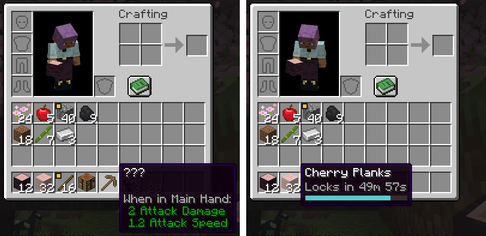

  

<h1 align="center">Oboecraft</h1>

  A Fabric mod for Minecraft that teaches the Japanese names of the game's items with spaced repetition.

  

Every item in the game starts out locked. You can move a locked item around in your inventory, but to place it, use it, craft with it or put it in a chest, you first type its Japanese name, the name it has in the Japanese version of Minecraft. A correct answer unlocks every stack of that item for a while. Each correct answer makes the time longer, from 10 minutes up to a month, until the item is mastered and never locks again. A wrong answer costs you part of the item.

The name comes from 覚える (*oboeru*), "to memorize". See [the project idea](docs/idea.md) for where it started.

## Playing

### What you need

- Minecraft: Java Edition 26.3
- [Fabric Loader](https://fabricmc.net/use/) 0.20.1 or newer
- [Fabric API](https://modrinth.com/mod/fabric-api) for Minecraft 26.3
- Optional: [Mod Menu](https://modrinth.com/mod/modmenu) for Minecraft 26.3, to open the settings screen

### Installing

1. Install Fabric Loader for Minecraft 26.3 with the [Fabric installer](https://fabricmc.net/use/).
2. Download Fabric API for Minecraft 26.3.
3. Download `oboecraft-<version>.jar` from the [latest release](https://github.com/willdalh/oboecraft/releases/latest).
4. Put the jars, and Mod Menu's if you want it, in the `mods` folder of your Minecraft folder, then start the game with the Fabric profile in the launcher.

On a server, install Fabric Loader, Fabric API and Oboecraft on the server too. Every player needs the same version of Oboecraft as the server, and players without it can't join.

Your progress in singleplayer is shared by all your worlds, so a new world doesn't start over. Each server keeps its own progress for each player.

### How to play

The mod is made for playing with the game in Japanese: choose 日本語 under Options → Language. Typing in Japanese with your keyboard's Japanese input works too.

- A locked item's name is hidden as `???`. Using it opens the answer menu. You can also right-click a locked item in your inventory to open it.
- Type the item's Japanese name in kanji, kana or romaji, or a mix, and press Enter. For an oak log, `オークの原木`, `おーくのげんぼく` and `ookunogenboku` are all correct. Spaces and the particle の are optional.
- The first time you meet an item, the answer menu is a lesson. Press F9 to see the answer, then type it. Nothing is lost in a lesson.
- After that, you get two attempts. Two wrong answers, or Delete for "Don't know", is a fail: part of the item is removed from your inventory and the open container, the item goes down a level, and it can't be answered again for 5 minutes. A fail at level 1 removes half, and higher levels remove less. The answer is shown after a fail.
- A correct answer shows the Japanese name, with its kanji, at the top of the screen. Hovering over an unlocked item shows the time until it locks again, and its slot gets a marker when it is close.
- Press F7 for "Already known" to unlock an item you know forever, or F8 to ignore an item you don't want to learn. Ignored items are dropped and can't be picked up. Press J to open the word list, where you can put known, ignored and mastered items back to level 0.
- Esc closes the answer menu without losing anything, and the item stays locked.
- In creative and spectator mode nothing is locked, and your progress is kept.
- An anvil only renames name tags, so you can't give an item a name of your own.

All keys can be changed under Options → Controls, in the Oboecraft section.

A correct answer shows the name as it is written, even when you typed it in romaji:

  

Locked items show `???` in place of their names. Unlocked items show how long they have left, and items close to locking get an amber marker on their slot, like the sticks and cobblestone here:

  

After a fail, the answer menu shows the name and its reading:

  

### Which answers count

The rule is that the same sound passes and a different sound fails. Each name is split into parts with their readings, like サクラ, の, 原 (げん) and 木 (ぼく), and every part can be typed as written, in hiragana or katakana, or in romaji.

| Answer for サクラの原木 (cherry log) | Result | Why |
|---|---|---|
| `サクラの原木` | Pass | As written |
| `さくらのげんぼく` | Pass | All kana |
| `sakura no genboku` | Pass | Romaji |
| `sakuraの原木` | Pass | Romaji, kana and kanji mixed |
| `サクラ原木` | Pass | The particle の is optional |
| `サクラの原き` | Fail | き isn't the reading of 木 here |
| `サクラの元木` | Fail | Same sound, but the wrong kanji |

Long vowels can be written several ways (`ōku`, `ooku`, `ouku` and `o-ku` for オーク), both romaji styles pass (`shi` and `si`, `tsu` and `tu`), and punctuation and case are ignored. The full rules are in [Answers](docs/design/answers.md).

The names and readings come from a name list of about 1,700 items, made from Minecraft's Japanese translation with the help of JMdict, KANJIDIC2 and Sudachi, and reviewed by hand.

### Levels

| Level | Unlocked for | A fail moves it down |
|---|---|---|
| 0 | Lesson | — |
| 1 | 10 minutes | Stays at 1 |
| 2 | 1 hour | 1 level |
| 3 | 4 hours | 1 level |
| 4 | 1 day | 1 level |
| 5 | 3 days | 2 levels |
| 6 | 1 week | 2 levels |
| 7 | 2 weeks | 2 levels |
| 8 | 1 month | 2 levels |
| 9 | Mastered | — |

The times use real-world time, so items keep locking while you are away from the game.

### Settings

The times and amounts above are the defaults. With Mod Menu installed, open the settings from Oboecraft in its mod list. Without it, edit the files in the `config/oboecraft` folder of your Minecraft folder.

- **Clickable buttons:** the answer menu shows a button for each action, besides the keys. Each player chooses this on their own computer.
- **The rules:** the levels with their intervals and demotions, the ban length, how much less a fail removes at each level, and whether dropping an item counts as using it. In singleplayer you choose them, and they apply to all your worlds. On a server, the owner sets them in `config/oboecraft/server.json` in the server's folder, which the server reads when it starts. The settings screen shows them there but can't change them.

## License

The code is under the [MIT license](LICENSE). The Japanese names come from Minecraft, and the readings in the name list are under CC BY-SA 4.0. See [`CREDITS.md`](CREDITS.md).

Oboecraft is not an official Minecraft product and is not approved by or associated with Mojang or Microsoft.

## Development

[AGENTS.md](AGENTS.md) has the commands to build, test and run the mod, and [`docs/`](docs/) describes how it works: the [design](docs/design/README.md) of the game rules, the [architecture](docs/architecture/overview.md) of the code, and the [glossary](docs/glossary.md).
