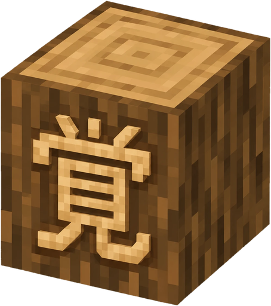
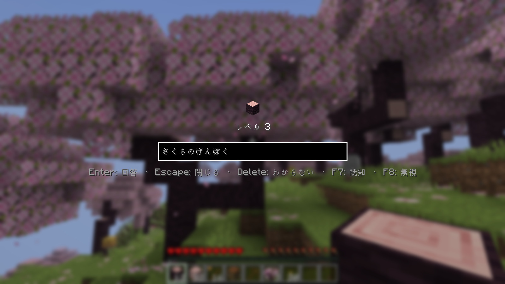
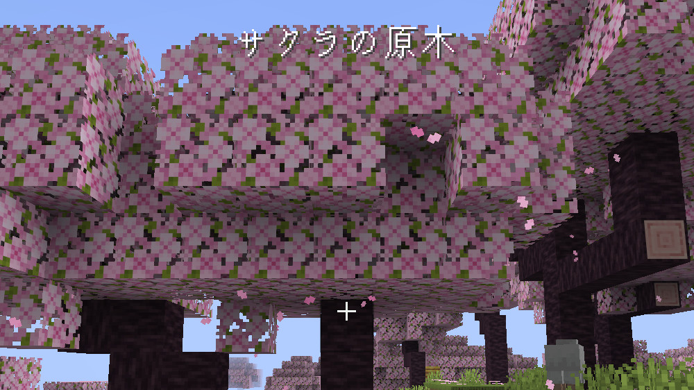
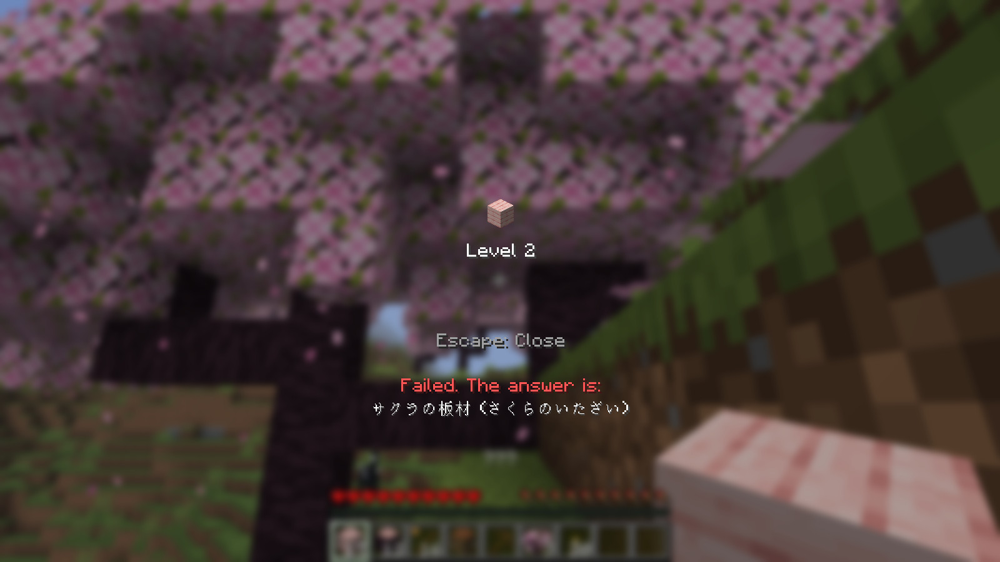
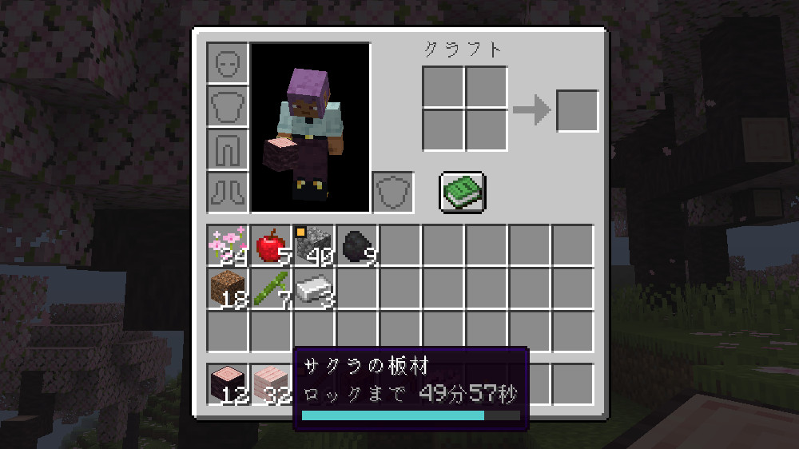
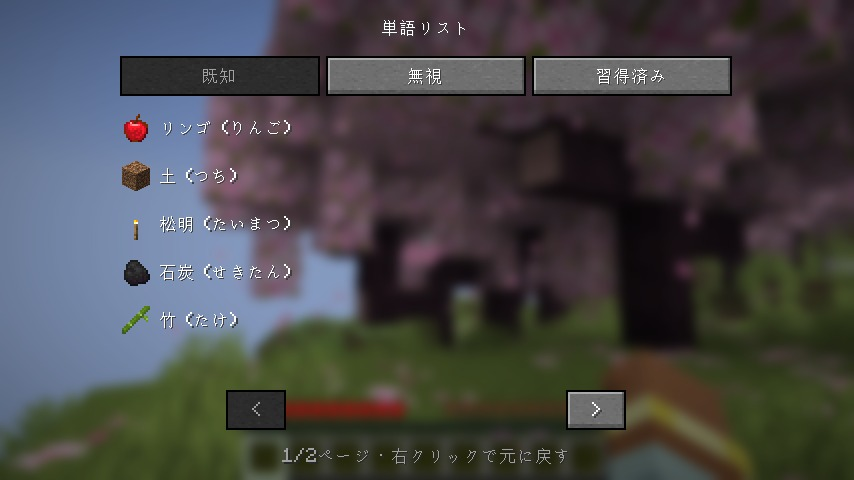

  

<h1 align="center">Oboecraft</h1>

  A Minecraft mod that locks every item until you can name it in Japanese.

  

Punch a tree and you get a log you can't use. To place it, craft with it or put it in a chest, you first type its name from the Japanese version of the game: サクラの原木. A correct answer unlocks every log of that kind for ten minutes. Each correct answer after that keeps it unlocked for longer, from an hour to a day to a month, until the word is mastered and never locks again. This is spaced repetition, and the game is the flashcard deck.

- **Any way of writing it counts.** サクラの原木, さくらのげんぼく and `sakura no genboku` all pass. The sound must be right, and so must the kanji: 元木 has the same sound and still fails.
- **Mistakes cost items.** You get two attempts. A fail removes up to half of that item from your inventory, moves it down a level and bans it for five minutes, so it can't be answered until the ban ends. Words you have known for longer lose less.
- **New items start with a lesson**, where you can see the answer and nothing is lost.
- **Names stay hidden.** A locked item is called `???` until you answer.
- **Hear every word.** After a correct answer, a voice says the name, so you learn how it sounds. Its volume is the Voice/Speech slider under Options → Music & Sounds.

<table>
  <tr>
    <td></td>
    <td></td>
  </tr>
  <tr>
    <td>A correct answer shows how the name is written, kanji included, and says it aloud.</td>
    <td>A fail shows the answer and its reading.</td>
  </tr>
  <tr>
    <td></td>
    <td></td>
  </tr>
  <tr>
    <td>Unlocked items show when they lock again. The amber corner means soon.</td>
    <td>The word list (J) keeps known, ignored and mastered words.</td>
  </tr>
</table>

## Installing

You need Minecraft: Java Edition 26.3 with [Fabric Loader](https://fabricmc.net/use/) 0.20.1 or newer and [Fabric API](https://modrinth.com/mod/fabric-api). Download `oboecraft-<version>.jar` from the [latest release](https://github.com/willdalh/oboecraft/releases/latest) and put it in your `mods` folder with Fabric API.

On a server, install the mod on the server too. Players need the same version of Oboecraft to join. The server checks every answer and keeps each player's progress. In singleplayer, your progress is shared by all your worlds.

Set the game language to 日本語 under Options → Language, so the names you learn are the ones you see. Locks only apply in survival and adventure mode.

## Keys

| Key | In the answer menu |
|---|---|
| Enter | Answer |
| Delete | Don't know: fails at once, or shows the answer in a lesson |
| F9 | Show the answer, in a lesson |
| F7 | Already known: unlock the item for good |
| F8 | Ignore: drop the item and never learn it |
| Esc | Close without losing anything |

J opens the word list, where known, ignored and mastered items can go back to level 0. You can right-click a locked item in your inventory to answer it without using it. All keys can be changed under Options → Controls.

## Settings

The levels, their intervals, the ban length and how much a fail removes can be changed with [Mod Menu](https://modrinth.com/mod/modmenu) or in `config/oboecraft/server.json`. On a server, only the server's owner can change them. Each player can also choose clickable buttons and the size of the item image above the answer field (50–400%) in Mod Menu or `config/oboecraft/client.json`. The image size applies to all reviews and leaves other item displays unchanged.

## License

The code is under the [MIT license](LICENSE). The Japanese names come from Minecraft, and the readings in the name list are under CC BY-SA 4.0. The spoken names are VOICEVOX:玄野武宏. See [`CREDITS.md`](CREDITS.md). Oboecraft is not an official Minecraft product and is not approved by or associated with Mojang or Microsoft.

[AGENTS.md](AGENTS.md) has the commands to build and test the mod, and [`docs/`](docs/) describes how it works.
