# Tsukumogami

When a player lets their reviews pile up, a 付喪神 (tsukumogami) follows them day and night. In folklore, tsukumogami are objects that come alive after years of neglect. Here, the player's own neglected items are its halo. It grows stronger the more items are overdue, stands still while its owner reviews, and leaves once enough reviews are done, so the backlog is felt in the game and the only real way out is to review. The proposal is [RFC-20261109](../rfcs/20261109-tsukumogami.md), and it was built in [willdalh/oboecraft#51](https://github.com/willdalh/oboecraft/issues/51), with its sounds from [#52](https://github.com/willdalh/oboecraft/issues/52).

The server decides everything about it. The client only draws it.

## The overdue count

An item is **overdue** when it is [locked](srs-state.md) at level 1 or higher. The **overdue count** is the number of different overdue items the player carries: in the inventory, the hotbar, the offhand and the stack on the cursor. Stack size doesn't matter, so 64 locked planks count as one.

- Banned items count, so a fail never makes the tsukumogami weaker. Otherwise pressing Don't know on every overdue item would be a cheap way out.
- Level 0 items don't count. They have never been learned, and counting them would punish exploring.
- Worn armor and items in containers don't count, since the player can only review what they carry.

## When it appears

A player's tsukumogami appears when all of these hold:

- The overdue count is at the **Tsukumogami threshold** or above. A threshold of 0 turns it off, see [Settings](settings.md).
- The player is alive in the Overworld, in survival or adventure mode, with their progress loaded, and the difficulty isn't Peaceful.
- It has no active 12,000-game-tick kill cooldown, and it isn't waiting (see below).

It can appear day or night, including in open sunlight, with no biome or light-level restriction. This is the per-player overdue-review mechanic, not natural monster spawning.

It arrives 16 to 24 blocks from its owner, on solid ground, out of the owner's sight if there is such a place, so it arrives instead of popping into view. A deep temple bell rings where it arrived, which only its owner hears, and its owner sees above the hotbar: "A tsukumogami is following you. Review your overdue items to drive it away."

Each player has at most one. A higher overdue count makes it stronger, not more numerous.

## What it does

It follows and attacks only its owner. It ignores other players and mobs, and mobs ignore it. Everyone can see it and its orbiting items, and only its owner sees its boss bar.

| Aspect | Behaviour |
|---|---|
| Moving | It walks slowly and never runs, slower than a player walks. It doesn't break or pass through blocks, open doors, ride anything or use portals, and nobody can push it. |
| Keeping up | When it is more than 32 blocks from its owner, or has made no progress for 3 seconds, it teleports to a place 16 to 24 blocks behind them. Where there is none, like over open water, it looks again a second later. Horses, boats, elytra and pillaring up don't shake it off. |
| Attacking | A slow, heavy hit with a visible wind-up of a second, its jaw opening and its hands raised. 4 HP on Normal, scaled by difficulty like vanilla mobs: 3 on Easy and 6 on Hard. After the hit it stands where it is for a second while it straightens up, so its owner can back away, and it starts its next attack a second and a half after the hit at the earliest. |
| Health | 20 HP at the threshold, plus 6 HP for each overdue item above it, up to 100 HP. When the overdue count changes, its max health changes and it keeps the same fraction of its health, so a pass in the middle of a fight weakens it at once. Damage and speed don't change. |
| Damage it takes | Only damage its owner causes: melee, arrows, tridents, thrown potions and anything else that has the owner as its attacker. Other players, other mobs and the owner's pets do nothing, and neither do lava, fire, falling, drowning, suffocation and cactus. Other players' hits play a dull sound, so nobody thinks it is broken. `/kill` and the void still work, also while it fades out. |
| During a review | While its owner has any review going, lessons included, it stands still and watches them, for at most the **Tsukumogami review freeze**. After that it moves again even with the answer menu open, so the menu can't be held open through the night. Every new review starts a new freeze, and it stays still for 2 seconds after a review ends, so the owner isn't hit the moment they are back. It can still be hurt while it stands still. With a freeze of 0, it never stands still. |
| During danger | Another living mob within 32 blocks targeting its owner suspends attacks, including an angered neutral mob. Sight and a path are not required, so a trapped targeting mob still counts. It cancels a pending strike and keeps following, then waits five continuous seconds without a threat before starting a fresh attack. A new threat restarts the wait. This works even when the review freeze expires or is 0, and reviews remain available. Idle mobs, mobs targeting someone else, environmental hazards and PvP do not count. |
| Sleeping | Its owner can't sleep while it exists, wherever it is, and is told why. They can't either while it should exist but is still waiting to arrive or has found no place to arrive, and an owner who is in bed when it arrives is woken. It doesn't stop other players from sleeping. |

In multiplayer, an owner who can't sleep holds up the night for everyone, unless the server lowers `playersSleepingPercentage`. That is accepted, since the owner can fix it by reviewing the items they carry.

## How it leaves

- **Reviewing:** when the overdue count drops below the threshold, its orbiting items fall away and it fades out on the spot, with a wind chime. If the count rises to the threshold again, it comes back after 30 seconds. The server checks right after each review, so this happens at once.
- **Killing:** it is gone for 12,000 elapsed game ticks from the kill: half a Minecraft day, about 10 minutes at 20 ticks per second. Skipping or changing sky time does not consume this relief. Afterward it may return if the usual eligibility and delay rules allow it.
- Sunrise does not make it fade or disappear.
- Its owner dying, logging out, leaving the Overworld or changing to creative or spectator mode removes it, and so does Peaceful. After that the normal rules apply again, 10 seconds after the owner respawns, joins, returns to the Overworld or returns to survival or adventure mode, or later if it was reviewed away less than 30 seconds before. Changing between survival and adventure mode changes nothing. Logging out never gets rid of it for good.

It drops nothing, neither items nor experience, whether it is killed or reviewed away, so it never pays to call it.

It is never saved with the world. Whether it should exist is worked out from its owner's progress and the world, and its kill cooldown is only remembered while the server runs, so a restart forgets it. See [ADR: The tsukumogami is never saved with the world](../decisions/20261109-tsukumogami-never-saved.md).

## What the owner sees

- The message above the hotbar each time it appears.
- A boss bar, only for its owner, with its name and the overdue count, like 付喪神 (7), which shows its health. The threshold isn't shown, so the goal is "review until it leaves", not "do the minimum".
- During danger and the five-second grace period, the boss bar adds “Waiting until you’re safe” alongside the overdue count.
- Its name is 付喪神 in Japanese and Tsukumogami in English, following the game language like the rest of the mod's text.

## Look

It is a menreiki (面霊気), a noh mask that came alive:

- Tall and stooped, about 2.8 blocks, in a frayed, faded indigo kimono, worn left over right, that drags a torn train on the ground, with a red obi tied in a knot at the back. Its geta show under the hem when it walks.
- Its face is an old noh mask over long black hair: pale, with a crack down from the forehead through one eyebrow, lacquer peeled off down to the wood at its edges, painted eyebrows high on the forehead, blackened teeth and a dim glow in the narrow eye holes. The mask's jaw is a separate piece, which drops open when it attacks.
- Its hands are long and thin like old wooden tool handles, with fingers that reach its knees, and broken things hang from its sash: a snapped comb, a cracked bell and a chipped cup.
- Its owner's overdue items orbit its shoulders slowly, shown as their icons, like a dark halo. Each passed review knocks one out of the ring, and the others close up. At most 12 orbit it, the first overdue items the owner carries.

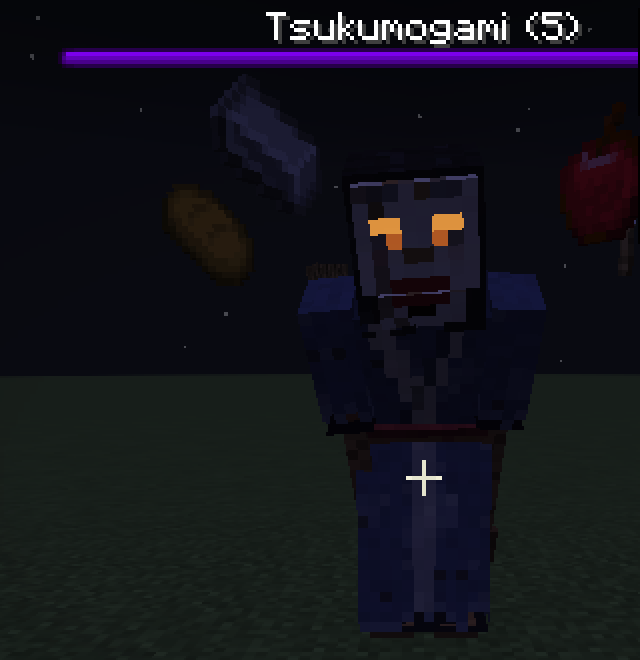

It moves slowly and heavily, never suddenly except in the hit itself. The heavy parts lead, and its sleeves, its hair, the train and the things on its sash come after them:

| When | How it moves |
|---|---|
| It stands | It breathes and sways so slowly that it nearly stands still, and its fingers curl and straighten. The mask stays steadier than the body. |
| It walks | Two sliding steps for every 2.2 blocks, one for each step that sounds. It leans over the foot that stands, the knee pushes the front of the kimono out as the other foot slides forward, it sinks as the step lands, and the mask stays level and on its owner. |
| It attacks | Over the wind-up it rears up with both hands raised behind its head, its jaw opening and its eyes flaring up, and holds. Then it brings its hands down fast, so that they are down when the hit lands, and straightens up slowly while its sleeves and hair swing out and settle and its jaw clacks shut. |
| A review starts | It leans in with its head tilted and its hands half raised, and holds that. Every few seconds it tilts its head the other way, quickly, and holds again. An attack that the review interrupts stops where it is and settles into this: it never finishes a hit that wasn't made. |
| It is hurt | A short, stiff jolt back from the blow, the mask knocked aside. |
| It fades out | Its items fall away, its hands and jaw drop and its head sinks. It dissolves from the hem of its kimono upwards, a few pixels at a time, and the mask and the glow in its eyes go last. Its shadow goes with it. |
| It is killed | The blow knocks it back, the kimono falls in on itself, and the mask tips up and comes down on it last, before it is gone. It doesn't fall over like other mobs. |

Each of these blends into the next over about a third of a second, so it never snaps from one pose to another.

The recordings below are from the game, on a lit stage so that the motion shows. At night it is as dark as in the picture above.

| Walking | Attacking | Attacking, as its owner sees it |
|---|---|---|
| 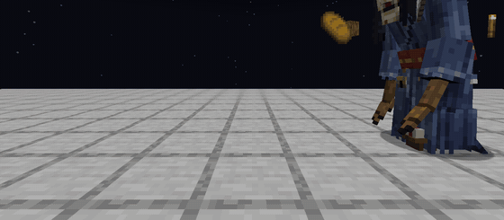 | 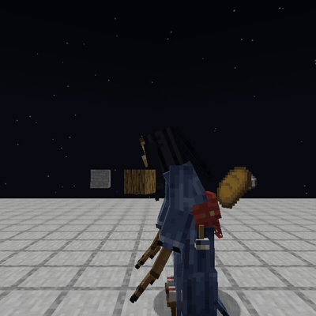 | 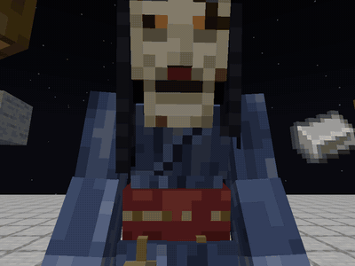 |

| A review starts | It is hurt |
|---|---|
| 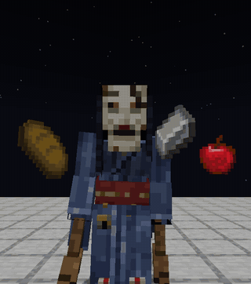 | 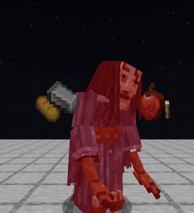 |

| Fading out | Killed |
|---|---|
| 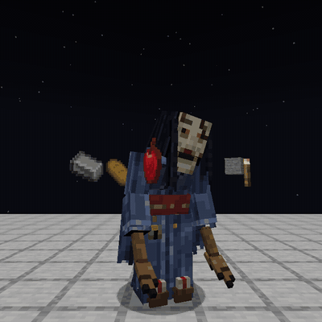 | 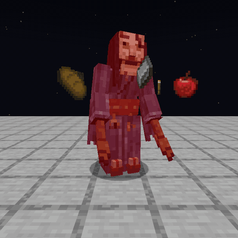 |

And this is what its owner sees of it at night, with its boss bar, in screenshots from the game:

| It stands | The wind-up | The hit |
|---|---|---|
| 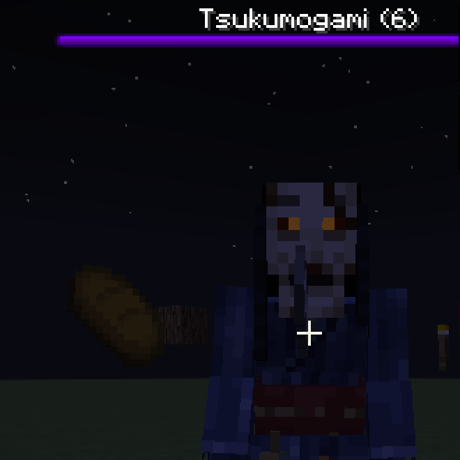 | 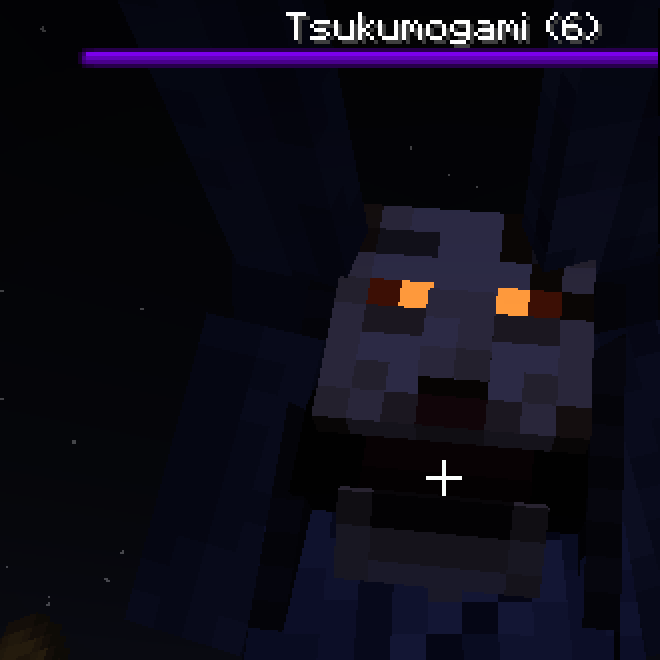 | 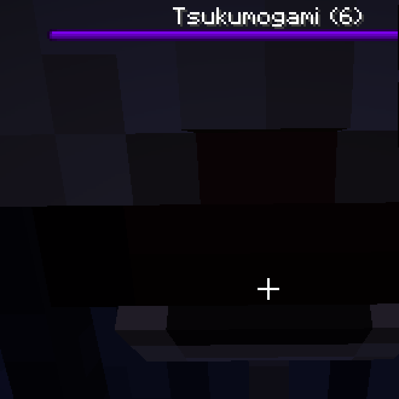 |

| A review starts | A pass knocks an item out | It fades out |
|---|---|---|
| 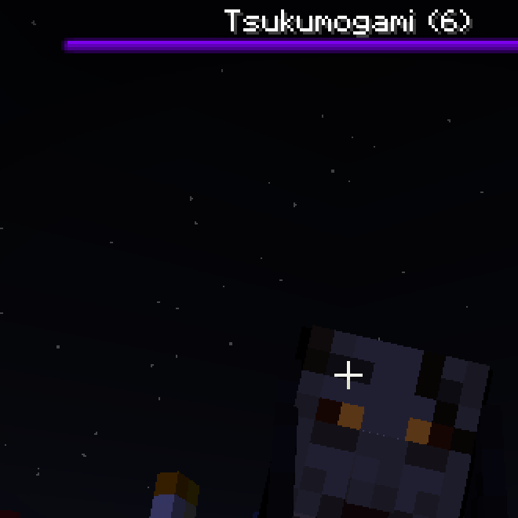 | 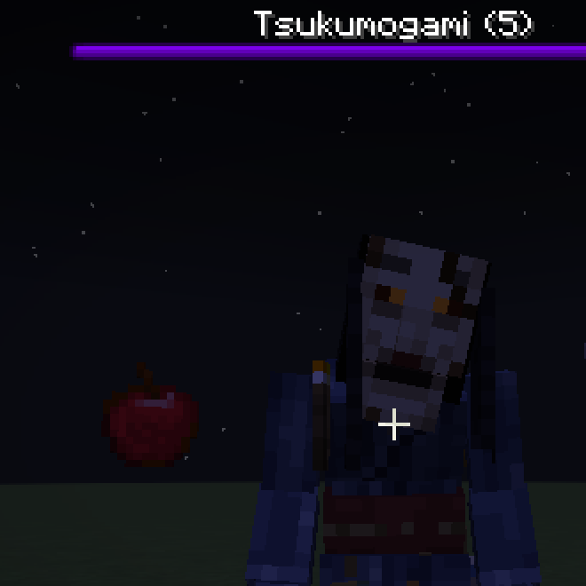 | 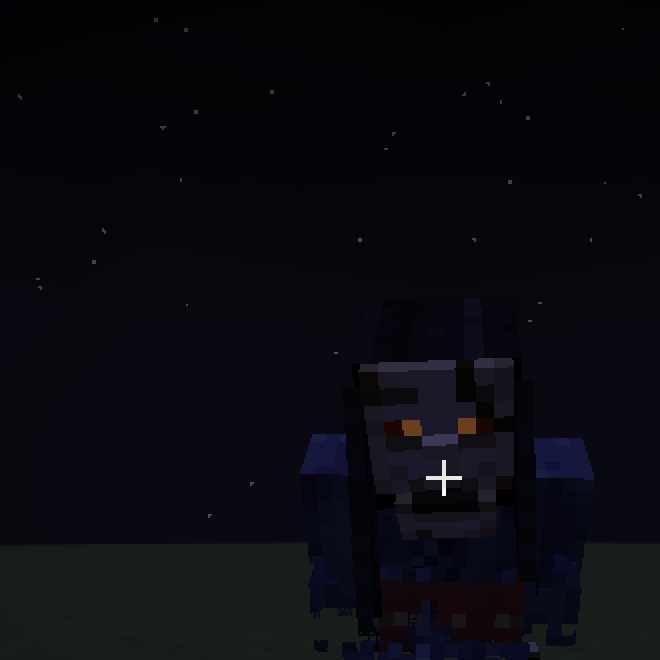 |

It is made with Minecraft's own entity models and keyframe animations, with a glowing layer for the eyes, Minecraft's own dissolve for the fade-out and no animation library, so the mod still only needs Fabric API. It was reworked in [willdalh/oboecraft#53](https://github.com/willdalh/oboecraft/issues/53).

## Sounds

| When | Sound | Heard by |
|---|---|---|
| It arrives | A single deep temple bell (梵鐘), from where it arrived | Its owner only |
| It walks | Slow, heavy geta steps and the drag of its kimono, one for every 1.1 blocks it walks, so it is heard before it is seen | Everyone nearby |
| It is idle | Creaking wood and a low breath through the mask | Everyone nearby |
| Its attack winds up | The mask's jaw creaking open and clacking | Everyone nearby |
| It strikes | A heavy thud, at the end of the wind-up, whether it hits or not | Everyone nearby |
| It is hurt | A knock on lacquered wood and the rustle of its kimono | Everyone nearby |
| Anyone but its owner hits it | A dull knock with no effect | Everyone nearby |
| It is killed | The mask cracking apart, its pieces clattering down and the kimono collapsing | Everyone nearby |
| It fades out after reviews | A soft wind chime (風鈴), as a relief | Everyone nearby |

The bell is only for its owner, since it follows nobody else. Steps, idle sounds and hurt sounds come in a few versions, so they don't repeat. Each sound has a subtitle.

It never speaks, and never says the names of the overdue items, since that would give the answers away. Where each sound comes from is in [`CREDITS.md`](../../CREDITS.md).

## Settings

| Setting | Default | Meaning |
|---|---|---|
| Tsukumogami threshold | 5 | The overdue count it appears at, from 0 to 1,000. 0 turns it off |
| Tsukumogami review freeze | 60s | How long it stands still during one review, from 0 to 1 hour. 0 means it never stands still |

Both are [server settings](settings.md). The other numbers on this page are fixed rules.

## Performance

The server checks players with the threshold above 0, once a second throughout day and night, and a player right after each of their reviews ends, so the fade-out and the boss bar react at once.

Each existing tsukumogami checks nearby mobs targeting its owner on every AI tick, before a strike can land. The search is limited to the 32-block area around its owner.
